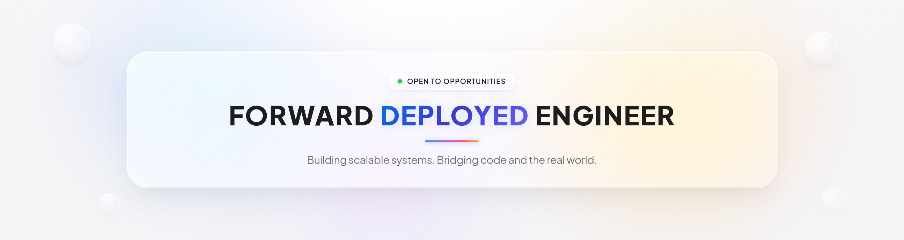

#  About Me:
Hi, I'm Soham Mokashi, an aspiring Forward Deployed Engineer currently pursuing my second year of B.Tech in Computer Science and Engineering (AI/ML) at Vishwakarma University.  I'm passionate about backend engineering, DevOps, and building scalable systems. I love participating in hackathons, exploring new technologies, and turning my ideas into beautiful, practical projects that solve real-world problems.  I'm continuously improving my problem-solving skills through Codeforces and LeetCode while learning more about backend systems, infrastructure, and software engineering.  My goal is to build impactful products, solve meaningful problems, and bridge the gap between technology and real-world needs.

## 🌐 Socials:
      

# 💻 Tech Stack

Languages

  

Frontend & Frameworks

  

Backend & APIs

  

Databases

  

Cloud · DevOps · Tools

  

# 📊 GitHub Stats:
 
 

### ✍️ Random Dev Quote

---

<!-- Proudly created with GPRM ( https://gprm.itsvg.in ) -->
